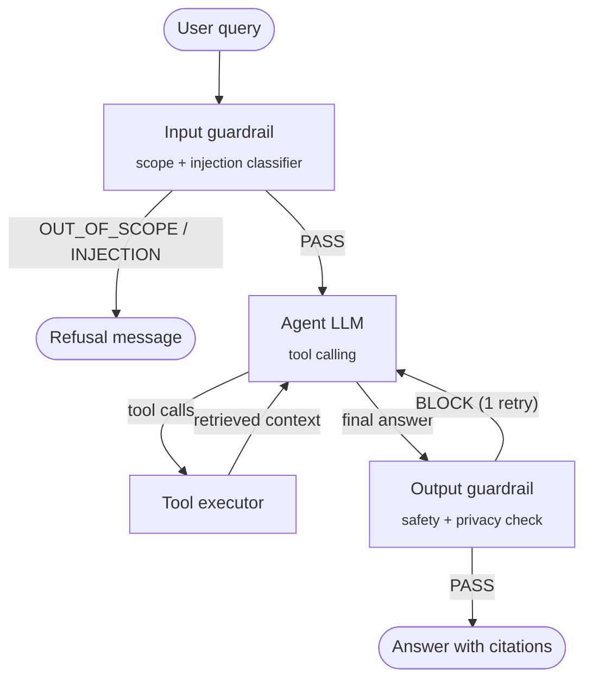
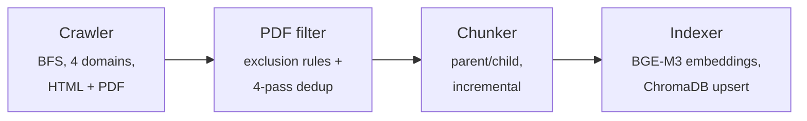

# Agentic RAG University Assistant


A virtual assistant for the **Department of Information and Electrical Engineering and Applied Mathematics (DIEM)** of the University of Salerno. It answers questions from students, prospective students and visitors (degree programmes, exams and timetables, faculty office hours, regulations, labs, Erasmus) using **only** information retrieved from the department's public websites, and cites its sources.

It is built as an **agentic RAG** system: an LLM agent orchestrated with LangGraph decides which specialised search tool to call, can call several in sequence, computes values such as the final degree grade with a sandboxed calculator, and is wrapped by input and output guardrails.

Developed as a group project for the *Natural Language Processing and Large Language Models* course (MSc in Computer Engineering, University of Salerno, A.Y. 2025-2026).

<!-- DEMO: a GIF/video of the Chainlit interface goes here -->

## Highlights

- **Agentic retrieval**: a LangGraph ReAct agent with domain-specific tools (faculty, courses, department) and optional metadata filters, instead of a single fixed retrieval step.
- **Parent-child retrieval + reranking**: small child chunks are embedded for precise matching, larger parent chunks are passed to the LLM for context; candidates are reranked with a cross-encoder.
- **Grounded answers with citations**: the agent is forced to retrieve before answering and must cite the source URLs it used.
- **Deterministic calculations**: grade formulas are retrieved from the official regulations and evaluated with an AST-based safe calculator, never with `eval`.
- **Guardrails**: an input classifier blocks out-of-scope requests and prompt injections; an output check blocks offensive content and private personal data, with one automatic retry.
- **Incremental knowledge base**: a crawler for four university domains, PDF filtering and deduplication, and content-hash-based incremental re-indexing.
- **Bilingual**: answers in Italian or English, matching the user's language.

## Architecture

### Agent graph (LangGraph)



The agent can call tools up to 5 times per question, then it must answer with the context it has. The last 5 conversation turns are kept as memory, so follow-up questions work (*"Who is Prof. X?"* → *"Which courses does he teach?"*).

### Tools

| Tool | Searches | Used for |
|---|---|---|
| `search_faculty` | `docenti.unisa.it` | office hours, courses taught, research, publications |
| `search_courses` | `corsi.unisa.it`, EasyCourse | syllabi, study plans, exams, timetables, admissions, regulations |
| `search_department` | `www.diem.unisa.it` | committees, labs, research areas, Erasmus, notices |
| `compute` | — | safe arithmetic for grade formulas retrieved from regulations |
| `out_of_scope_response` | — | explicit fallback when nothing relevant is found |

Each search tool restricts the vector search to its domain and accepts an optional `section_filter` (e.g. `curriculum`, `piano_studi`, `orario_lezioni`) derived from URL metadata.

### Retrieval pipeline

1. **Bi-encoder search**: BGE-M3 embeddings over child chunks (400 chars) in ChromaDB, top 50, with metadata filters.
2. **Parent lookup**: each child is mapped to its parent chunk (1,200 chars), deduplicated.
3. **Reranking**: cross-encoder reranking (Cohere `rerank-4-pro` via OpenRouter, or local `BAAI/bge-reranker-v2-m3`), top 15 passed to the agent.

### Knowledge base ingestion



- **Crawler**: whitelists built from the department's personnel and degree-programme pages; HTML extracted to Markdown with Trafilatura (tables preserved) and PDFs with PyMuPDF4LLM.
- **Metadata**: domain and section type derived deterministically from each URL, no LLM calls.
- **Incremental updates**: stable SHA-256 IDs and content hashes, so only new or changed documents are re-embedded and removed pages are deleted from the index. `update_knowledge_base.py --schedule` re-runs the whole pipeline weekly.

## Tech stack

| Area | Tools |
|---|---|
| Agent orchestration | LangGraph, LangChain |
| LLMs (via OpenRouter) | `openai/gpt-oss-120b` (agent), `meta-llama/llama-3.1-8b-instruct` (guardrails) |
| Embeddings | `BAAI/bge-m3` (Sentence-Transformers) |
| Vector store | ChromaDB |
| Reranking | Cohere `rerank-4-pro` or `BAAI/bge-reranker-v2-m3` |
| Ingestion | Requests, BeautifulSoup, Trafilatura, PyMuPDF4LLM |
| Interface | Chainlit (web), CLI |
| Evaluation | RAGAS |

The LLM provider is configurable in `config.py` (OpenRouter, Ollama, Hugging Face).

## Project structure

```
├── agent/
│   ├── graph.py            # LangGraph state machine
│   ├── nodes.py            # agent and tool-executor nodes
│   ├── tools.py            # search tools, safe calculator, fallback
│   ├── prompts.py          # system prompt and guardrail prompts
│   └── state.py            # shared agent state
├── guardrails/
│   ├── input_guard.py      # scope / injection classifier
│   └── output_guard.py     # safety and privacy check with retry
├── retrieval/
│   ├── retriever.py        # child search → parent lookup → rerank
│   └── reranker.py         # local or API-based cross-encoder
├── ingestion/
│   ├── crawler.py          # BFS crawler for the four university domains
│   ├── pdf_filter.py       # PDF exclusion rules and deduplication
│   ├── metadata_extractor.py
│   ├── chunker.py          # incremental parent/child chunking
│   └── indexer.py          # incremental embedding + ChromaDB upsert
├── others/                 # analysis and validation utilities for the knowledge base
├── docs/example_questions.md
├── core.py                 # system initialisation and query entry point
├── app_chainlit.py         # web interface
├── app_CLI.py              # terminal interface
├── update_knowledge_base.py
├── evaluate_ragas.py
└── config.py               # all settings in one place
```

## Getting started

### 1. Install

```bash
git clone https://github.com/RaffaeleRosanova01/agentic-rag-university-assistant.git
cd agentic-rag-university-assistant
pip install torch            # pick the build for your CPU/GPU from pytorch.org
pip install -r requirements.txt
```

### 2. Configure

Copy `.env.example` to `.env` and add your keys. An [OpenRouter](https://openrouter.ai) key is enough with the default configuration:

```
OPENROUTER_API_KEY=...
HF_TOKEN=...
```

Models, retrieval parameters and the guardrail switch are in `config.py`.

### 3. Build the knowledge base

The vector store is not included in the repository. Build it by crawling the public university websites:

```bash
python update_knowledge_base.py
```

This crawls the four domains with a polite delay between requests, so the first run takes a while; later runs only re-index what changed. Note that the EasyCourse timetable URL in `config.py` refers to a specific academic year.

### 4. Run

```bash
chainlit run app_chainlit.py    # web interface on http://localhost:8000
python app_CLI.py               # terminal interface
```

See [docs/example_questions.md](docs/example_questions.md) for questions to try.

## Evaluation

`evaluate_ragas.py` runs a hand-written test set of 17 questions with reference answers and source URLs through the agent, and computes RAGAS metrics (context precision and recall, faithfulness, answer relevancy).

We used it mainly as a development tool. Standard RAGAS metrics assume a single retrieval step, while this agent may call several tools and accumulate context across iterations, so the scores were not a reliable measure of answer quality and are not reported here. The system was validated mainly through manual testing on the example questions.

## Authors

Group project:

- **Raffaele Rosanova** ([@RaffaeleRosanova01](https://github.com/RaffaeleRosanova01)) — repository maintainer
- **Davide Iannone**
- **Antonio Martino**
- **Matteo La Manna** ([@matteolmn3](https://github.com/matteolmn3))

## Disclaimer

This is an academic project and not an official service of the University of Salerno. Answers are generated from publicly available web pages and may be incomplete or outdated: always check the official sources.
